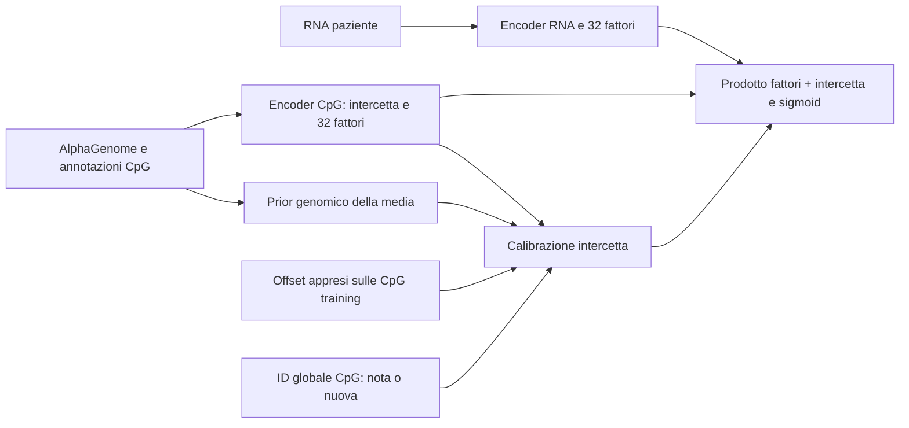

# AlphaGenome: prior genomico e intercette specifiche delle CpG note

> **Allineamento del benchmark, 18 ottobre 2026:** l’audit sulle predizioni rilasciate di MethylProphet ha trovato 723 pazienti validation diversi nello split derivato usato da questa campagna. I risultati sotto restano riferiti agli assi qui descritti; il confronto appaiato con il modello pubblicato usa invece lo split canonico verificato su tutti gli ID e target. Vedere il [nuovo benchmark misto](ALPHAGENOME_MIXED_METHYLPROPHET_2026-10-18.md).

Guardrail interni: **True**. Conferma dev: **True**.

Candidato congelato prima della conferma dev: `v2_early`, prior nuove CpG 0.25, calibrazione empirica CpG note 1.

## Ipotesi e protocollo

Il prior genomico già testato nella v2 migliorava la MSE delle CpG nuove ma sacrificava quelle note. Qui si separano esplicitamente le due fonti di informazione: il prior è usato sui loci mai osservati; per quelli training si può apprendere un’intercetta specifica senza richiedere target durante l’inferenza.

- Nessun ulteriore fit degli encoder: cinque sorgenti congelate (v1/v2 a 1.000 step e tre continuazioni v2), tre seed, tre fold interni.
- Nuove CpG: media beta del modello su 512 pazienti training combinata con prior Ridge AlphaGenome (alpha 100), pesi 0 / 0,25 / 0,5; offset risolto monotonamente.
- CpG note: media beta sui soli valori osservati nei pazienti training combinata con la media predetta sugli stessi valori, pesi 0 / 0,5 / 1; unico offset per locus, risposta RNA mantenuta.
- Il caso CpG nota viene definito dall’appartenenza agli ID di fit, non dall’errore sui pazienti esclusi. Per le nuove CpG non si legge alcuna metilazione né statistica osservata.
- Protocollo separato congelato prima delle valutazioni di questa verifica; ipotesi motivata dai risultati precedenti, quindi sviluppo adattivo. Nessuna valutazione dell’holdout ufficiale.
- Stessi guardrail stretti della ricerca precedente: nuove MSE almeno −0,5%, note MSE/MAE entro +1%, nuove MAE non peggiore, PCC/WT entro −0,002, errori >0,2 entro +0,001.

## Migliori candidati interni

| Sorgente | Prior nuove | Adattamento note | MSE nuove | MSE note | Ammissibile |
|---|---:|---:|---:|---:|---|
| v2_early | 0.25 | 1 | 0.025696 | 0.013440 | True |
| v2_early | 0.25 | 0.5 | 0.025696 | 0.014013 | True |
| freeze_cpg | 0.25 | 1 | 0.025864 | 0.013292 | True |
| freeze_cpg | 0.25 | 0.5 | 0.025864 | 0.013854 | True |
| v1_early | 0.5 | 1 | 0.025968 | 0.013414 | True |
| v1_early | 0.5 | 0.5 | 0.025968 | 0.013870 | True |
| v1_early | 0.5 | 0 | 0.025968 | 0.015462 | True |
| v1_early | 0.25 | 1 | 0.026382 | 0.013414 | True |
| v1_early | 0.25 | 0.5 | 0.026382 | 0.013870 | True |
| v1_early | 0.25 | 0 | 0.026382 | 0.015462 | True |
| v2_early | 0.5 | 1 | 0.025428 | 0.013440 | False |
| v2_early | 0.5 | 0.5 | 0.025428 | 0.014013 | False |
| v2_early | 0.5 | 0 | 0.025428 | 0.015910 | False |
| freeze_cpg | 0.5 | 1 | 0.025479 | 0.013292 | False |
| freeze_cpg | 0.5 | 0.5 | 0.025479 | 0.013854 | False |

## Conferma dev

| Modello | MSE nuove | MSE note | MAE nuove | PCC nuove | WT nuove | Errori >0,2 |
|---|---:|---:|---:|---:|---:|---:|
| v1 | 0.026422 | 0.017172 | 0.10630 | 0.52686 | 0.36252 | 17.47% |
| v2 | 0.025633 | 0.017861 | 0.10651 | 0.52724 | 0.36245 | 17.45% |
| candidate | 0.025059 | 0.013852 | 0.10617 | 0.52769 | 0.36251 | 17.19% |

Guardrail dev: novel_mse=True, known_mse=True, novel_mae=True, known_mae=True, novel_pcc=True, known_pcc=True, novel_within=True, known_within=True, severe=True.

Audit su 3,972 CpG nuove, errori mediati sui seed: migliora il 60.8% rispetto a v1 e il 58.9% rispetto a v2. ΔMSE vs v1 -0.001363, di cui bias² -0.001098 ed errore centrato -0.000265.

## Artefatti e limiti

[Figura](experiments/alphagenome_hierarchical_2026-10-18.png) · [Metriche](experiments/alphagenome_hierarchical_2026-10-18.json) · [Selezione](experiments/alphagenome_hierarchical_2026-10-18_selection.csv) · [Errori CpG](experiments/alphagenome_hierarchical_2026-10-18_errors.csv.gz) · [Peggiori 100](experiments/alphagenome_hierarchical_2026-10-18_worst100.csv)

Array chr1; fold e dev già utilizzati nello sviluppo. Non costituisce conferma esterna né dimostra ottimalità. I riferimenti v1 sono i controlli interni a 1.000 step; non rappresentano il massimo risultato ottenibile con qualsiasi durata di fit. La calibrazione di un’intercetta mantiene i fattori ma, per la non linearità della sigmoid, può cambiare PCC e within-tissue. Le statistiche delle CpG note sono parametri stimati sui target training; non sono ammesse per CpG nuove.

Riproduzione: `python scripts/search_alphagenome_hierarchical.py`; rendering con matplotlib: `python scripts/report_alphagenome_hierarchical.py`.

## Architettura selezionata

Il corpo è la v2 local01 a 1.000 step: encoder RNA condiviso, rappresentazione CpG AlphaGenome+annotazioni, intercetta shallow e risposta profonda a rango 32. Il recupero dei vicini e il congelamento aggiuntivo non sono attivi. La penalità locale della v2 resta una componente del training.

Per una CpG nuova, la media sulla popolazione RNA di riferimento è combinata al 75% con quella del modello e al 25% con il prior Ridge. Per una CpG nota, un offset stimato sui soli valori osservati nei pazienti training calibra il livello medio mantenendo i fattori. Gli ID servono a recuperare parametri appresi: non sono una scelta basata sugli errori di valutazione. La calibrazione si può precalcolare con i fattori CpG; il costo ricorrente mantiene un solo encoder RNA.

## Refit e confronto ufficiale a ricetta congelata

Tre refit su tutti gli assi training ufficiali. Il confronto primario usa seed17 e le stesse osservazioni di v1/v2. I seed18/19 misurano variabilità del candidato; il riferimento ufficiale v1 ha un solo seed.

| Vista | Modello | MSE | MAE | PCC | Within-tissue | Errori >0,2 |
|---|---|---:|---:|---:|---:|---:|
| CpG note / nuovi pazienti | v1 | 0.017964 | 0.08760 | 0.58996 | 0.39051 | 12.35% |
| CpG note / nuovi pazienti | v2 | 0.018731 | 0.09121 | 0.59030 | 0.38935 | 13.09% |
| CpG note / nuovi pazienti | gerarchico | 0.014173 | 0.07438 | 0.59373 | 0.38981 | 9.68% |
| CpG nuove / pazienti noti | v1 | 0.019663 | 0.08767 | 0.56388 | 0.45497 | 13.12% |
| CpG nuove / pazienti noti | v2 | 0.019423 | 0.08862 | 0.56381 | 0.45532 | 13.28% |
| CpG nuove / pazienti noti | gerarchico | 0.019207 | 0.08944 | 0.56333 | 0.45529 | 13.25% |
| CpG nuove / nuovi pazienti | v1 | 0.020030 | 0.08858 | 0.53443 | 0.34497 | 13.44% |
| CpG nuove / nuovi pazienti | v2 | 0.019772 | 0.08959 | 0.53722 | 0.34185 | 13.60% |
| CpG nuove / nuovi pazienti | gerarchico | 0.019543 | 0.09038 | 0.53721 | 0.34195 | 13.57% |

Nel confronto primario la MSE migliora del 2.43% sulle nuove CpG e del 21.11% sulle CpG note. La MAE double-OOD cambia da 0.08858 a 0.09038, la within-tissue da 0.34497 a 0.34195 e gli errori >0,2 da 13.44% a 13.57%: **il candidato non domina v1 su tutte le metriche ufficiali**. I criteri superati internamente e sul dev non si trasferiscono integralmente al confronto ufficiale. Nessun peso è stato ritoccato per correggere questo risultato.

| Seed gerarchico | MSE double-OOD | MSE CpG note | PCC double-OOD |
|---|---:|---:|---:|
| 17 | 0.019543 | 0.014173 | 0.53721 |
| 18 | 0.019639 | 0.014139 | 0.53789 |
| 19 | 0.019562 | 0.014135 | 0.53585 |

Migliora in MSE il 51.4% delle CpG rispetto a v1 e il 48.5% rispetto a v2. Persistono 660 CpG nel decile peggiore in almeno due seed su tre.

| CpG | Coordinate hg38 | RMSE beta | Bias | PCC |
|---|---|---:|---:|---:|
| cg13420845 | chr1:155250440 | 0.533 | +0.503 | 0.255 |
| cg27181253 | chr1:112509224 | 0.494 | -0.452 | 0.346 |
| cg26233753 | chr1:201347316 | 0.482 | +0.443 | 0.404 |
| cg26896499 | chr1:223362954 | 0.464 | +0.454 | 0.244 |
| cg03257417 | chr1:110647249 | 0.455 | +0.384 | 0.572 |
| cg08465307 | chr1:3910517 | 0.436 | +0.359 | 0.535 |
| cg11314684 | chr1:243842986 | 0.423 | +0.353 | 0.500 |
| cg25100475 | chr1:227563269 | 0.422 | -0.406 | 0.429 |
| cg21829336 | chr1:38257113 | 0.421 | +0.394 | 0.515 |
| cg14962509 | chr1:35574054 | 0.420 | -0.357 | 0.547 |

[Errori ufficiali completi](experiments/alphagenome_hierarchical_2026-10-18_official_errors.csv.gz) · [Peggiori 100](experiments/alphagenome_hierarchical_2026-10-18_official_worst100.csv) · [Maggiori regressioni](experiments/alphagenome_hierarchical_2026-10-18_official_regressions100.csv) · [Metriche](experiments/alphagenome_hierarchical_2026-10-18_official.json)

Checkpoint primario: `artifacts/alphagenome_hierarchical_2026-10-18/official/seed17/checkpoint.pt`. Inferenza con `AlphaGenomePredictorFromCheckpoint`, passando anche `cpg_ids=` con gli ID globali del registro, allineati alle feature. Gli ID non sono le posizioni delle righe né le stringhe Illumina cg.

Il livello medio delle CpG note è appreso esclusivamente dai pazienti training. Le CpG nuove usano solo il prior genomico e il predittore. Fattori e intercette si possono precalcolare; il decoder mantiene un solo encoder RNA e rango 32. Nessuna scelta è stata cambiata dopo i risultati ufficiali. L’holdout era già stato esaminato nello sviluppo v1/v2: non è una nuova conferma esterna.
