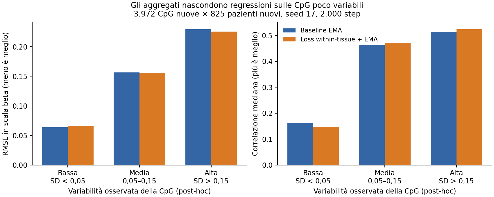

# Errori per tipo di CpG e direzioni computazionali

Analisi post-hoc del 17 ottobre 2026, eseguita senza training aggiuntivo.
Script: [analyze_cpg_errors.py](../scripts/analyze_cpg_errors.py).
Metriche aggregate: [JSON](experiments/cpg_error_audit_2026-10-17.json).

## Disegno

Tre checkpoint seed 17, step 2.000, EMA 0,99, scheduler horizon 4.000:
baseline, candidato MSE+PCC within-tissue, modello economico con FFN retrieval
8→2. Stessi 825 pazienti validation, tutte le 3.972 CpG validation e un campione
casuale fisso di 3.972 CpG training (seed 20261017).

Valutazione nuova in chunk di 128 pazienti e 512 CpG, BF16. Piccole differenze
numeriche rispetto alle metriche originali sono dovute al diverso batching
numerico; i confronti di questo documento usano tutti la stessa valutazione.
I tempi registrati includono warmup e trasferimenti e non sono un benchmark.

Stratificazioni: island/shore/shelf/open sea, promotore/esone/introne/intergenico,
cCRE, distanza TSS, numero tracce attive, distanza dalla CpG training più vicina,
blocco genomico, media e deviazione standard osservate della metilazione.
Le categorie biologiche sono decodificate dal contratto delle 18 annotazioni.
Le categorie derivate dai target validation sono esclusivamente descrittive:
non costituiscono input disponibili in deployment o criteri di selezione leciti.

Per ogni locus: PCC, MSE, bias medio, errore centrato, ampiezza delle predizioni,
frazione di errori assoluti >0,2 beta, correlazione sui residui centrati per
tessuto. I gruppi within-tissue hanno almeno 20 pazienti; `NA` è escluso.
La correlazione pooled sui residui per locus è diversa dalla media delle
mediane per tessuto usata negli screening. Le tabelle per singolo tessuto
richiedono almeno 10 target osservati per locus per la correlazione.

## Le metriche globali nascondono differenze importanti



Double-OOD, baseline e candidato con EMA:

| Variabilità osservata CpG | N | PCC baseline → candidato | RMSE baseline → candidato | CpG con MSE migliorata |
|---|---:|---:|---:|---:|
| SD < 0,05 | 815 | 0,1614 → 0,1473 | 0,0638 → 0,0658 | 25,9% |
| SD 0,05–0,15 | 1.309 | 0,4636 → 0,4705 | 0,1565 → 0,1559 | 45,7% |
| SD > 0,15 | 1.848 | 0,5129 → 0,5238 | 0,2298 → 0,2258 | 61,5% |

Il candidato favorisce prevalentemente CpG molto variabili e peggiora spesso
quelle poco variabili. Globalmente aumenta la PCC mediana (0,4523→0,4592)
e riduce la MSE (0,03340→0,03256), ma migliora la MSE soltanto nel 49,0%
dei loci. La frazione di errori >0,2 beta rimane circa 21,6% e non migliora
(21,553%→21,579%); la PCC del decile peggiore scende da 0,1288 a 0,1233.

Nel baseline, il rapporto mediano SD predetta/SD osservata è 1,63 sulle CpG
poco variabili e 0,54 su quelle molto variabili. Il candidato porta questi
rapporti a 1,73 e 0,50. Predizioni con varianza minore dell'osservata non sono
automaticamente mal calibrate: una media condizionale può avere varianza
minore del target per la componente imprevedibile. Non imporre rapporto 1
senza verificare accuratezza e rumore.

### Media, tipo genomico e concentrazione dell'errore

Con gli stessi target validi per locus vale esattamente:

`MSE = (media predetta − media osservata)^2 + MSE dei residui centrati`.

Nel double-OOD, **45,1% dell'SSE baseline è bias della media del locus**,
contro 24,7% nel campione di CpG note. È una scomposizione diagnostica
su medie validation, non un guadagno ottenibile usando medie note in inferenza.
Il 10% delle CpG nuove con più errore concentra il 36,5% dell'SSE baseline.

| Contesto | N nuove CpG | PCC mediana baseline | RMSE baseline |
|---|---:|---:|---:|
| Island | 1.069 | 0,3003 | 0,1299 |
| Shore | 834 | 0,4440 | 0,1947 |
| Shelf | 368 | 0,4866 | 0,1910 |
| Open sea | 1.701 | 0,4872 | 0,2026 |

La correlazione da sola farebbe sembrare peggiori le island, mentre l'errore
assoluto è maggiore nelle open sea. Il 46,3% delle island ha SD <0,05, contro
7,6% delle open sea. Limitandosi a SD 0,05–0,15, le PCC diventano rispettivamente
0,459 e 0,469: buona parte della differenza grezza riflette la variabilità.
Non attribuire causalmente l'errore alla categoria senza controllare questi fattori.

Regioni intergeniche: RMSE 0,219; promotori: 0,161. Anche questa differenza
è descrittiva. I gruppi piccoli cCRE non sostengono conclusioni robuste.
Le 3.972 CpG nuove appartengono a soli **cinque blocchi da 5 Mb**: non sono
3.972 osservazioni genomiche indipendenti. Una conferma richiede altri blocchi,
intervalli di incertezza per blocco/paziente e più seed.

## Una pista concreta: calcolo adattivo

Il modello FFN2 e il baseline completo hanno errori complementari. Come
diagnostica ottimistica si selezionano, usando gli errori validation, i loci
dove vale la pena usare il completo. Si impone un budget massimo di loci
costosi e si usa FFN2 negli altri; non si sceglie il completo se è peggiore.

| Budget massimo loci col completo | MSE double-OOD oracolo | MAC relativi dei soli FFN per coppia |
|---|---:|---:|
| 0% (solo FFN2) | 0,03312 | 0,40 |
| 10% | 0,03145 | 0,46 |
| 25% | 0,03104 | 0,55 |
| 50% (usati 46,6%) | 0,03096 | 0,68 |

Baseline completo su tutti i loci: MSE 0,03340. **Questa curva usa i target
validation per scegliere e non è una prestazione deployabile.** La selezione
può anche sfruttare rumore: il vantaggio recuperabile da feature è ignoto.

I MAC considerano otto retrieval FFN + due head FFN contro due + due:
5.242.880 contro 2.097.152 MAC per coppia paziente–CpG, per le sole proiezioni
lineari di questi blocchi (width 256, espansione 4×). Attenzione, encoder,
regressor restante, gating, memoria e scheduling sono esclusi. I modelli
indipendenti hanno encoder diversi e il routing reale deve gestirne il costo.
Per risparmiare bisogna selezionare prima di eseguire entrambi i modelli.

Test proposto: generare predizioni out-of-fold su blocchi training, misurare
il beneficio effettivo completo-vs-FFN2, e addestrare un piccolo gate sulle
feature CpG disponibili (eventualmente stato RNA). Valutare su blocchi nuovi
curve accuratezza/costo con percentuali costose prefissate. La difficoltà
assoluta della CpG non coincide necessariamente con il beneficio del modello
più grande. [Early exiting](https://arxiv.org/abs/1709.01686) è un precedente
generale; il test deve dimostrare il vantaggio in questo problema.

## Altre direzioni da esplorare

1. **Decoder fattorizzato come percorso principale.** Encoder RNA e CpG
   producono fattori `u_p` e `a_c`; i logit sono `b_c + u_p @ a_c.T`, con
   eventuale correzione costosa su una parte dei loci. La componente di
   interazione costa O(P*C*r), dopo gli encoder, invece di ripetere FFN
   O(d²) per ogni coppia. È diverso dal ramo bilineare aggiuntivo già testato,
   che manteneva l'intero decoder costoso e usava pooling dei token.
   Confrontare rango 16/32/64, MSE e within-tissue, latenza/memoria misurate.
   Una CpG che genera coefficienti di risposta è anche una forma semplice di
   condizionamento dei pesi, concetto generale delle
   [hypernetwork](https://arxiv.org/abs/1609.09106); originalità specifica da verificare.
2. **Calibrazione economica e condivisa.** Il bias medio motiva un calibratore
   a pochi parametri per contesto genomico/tessuto, appreso su predizioni
   out-of-fold. Confrontare sola correzione dell'offset e offset+scala;
   non usare medie o deviazioni target della CpG held-out. La precedente
   mean-anchor joint non migliorava: va distinta una calibrazione cross-fitted
   del predittore finito da un'altra variazione equivalente della testa.
3. **Cache esatte in inferenza.** Calcolare token RNA una volta per paziente
   e stato shallow/deep CpG una volta per locus, riusandoli nei chunk. Nel
   harness attuale il forward li ricalcola per ogni blocco dell'altra modalità.
   È un'ottimizzazione ingegneristica in eval a pesi fissi, non un contributo
   predittivo. Verificare equivalenza numerica e compromesso memoria/latenza;
   non riusare cache obsolete tra aggiornamenti dei pesi in training.

Priorità suggerita: completare l'audit out-of-fold, poi gate economico e
decoder fattorizzato. La stratificazione genomica supporta la scelta del test,
non basta da sola a giustificare esperti separati island/open-sea. I risultati
post-hoc su validation devono essere confermati su un nuovo split.

## Riproduzione e artefatti

Directory locale: `/data2/home/vcivale/projects/methylation/cpg_error_audit_2026-10-17/`.
Contiene `per_cpg.csv.gz`, `summary.json`, `run.log`; non vengono esportati
valori individuali RNA o metilazione. La snapshot JSON in repo include percorsi
e hash dei tre checkpoint. I target e il modello congelato richiedono `pi_lab`.

```bash
python scripts/analyze_cpg_errors.py \
  --lab /data2/home/vcivale/projects/methylation/pi_lab \
  --baseline /data2/home/vcivale/projects/methylation/rna_training_round2_2026-10-17/mean_training/results/dev/baseline/seed17_step2000.pt \
  --candidate /data2/home/vcivale/projects/methylation/rna_training_round2_2026-10-17/residual_loss/results/dev/wt_mse1_wt_pcc015/seed17_step2000.pt \
  --cheap /data2/home/vcivale/projects/methylation/training_hypotheses_lab/results/dev/random_ffn2_2k/seed17_step2000.pt \
  --out /tmp/cpg_error_audit
```

Controlli eseguiti: metriche su dati sintetici con NaN, correlazione costante
non definita, identità MSE=bias²+errore centrato, predizioni finite, identificativi
locus unici e allineati, 3.972 loci nuovi e cinque blocchi validation.
